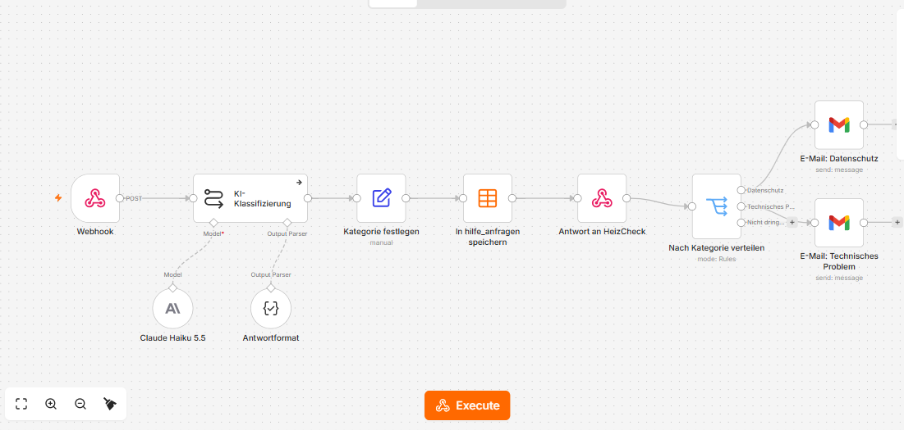

# Help chat via n8n (ticket 19)

A signed-in Property Manager clicks the "?" button bottom-right, types a message and sends it. HeizCheck forwards it to an n8n workflow. The workflow classifies the message with Claude Haiku 5.5, saves it and emails an alert when it is urgent. The widget then shows which category the message was filed under.

**This is dev/demo only (ADR 0004).** Never set `N8N_HELP_WEBHOOK_URL` in Vercel production, and test only with made-up messages, never real Tenant data.

## How it fits together

```text
"?" widget ──POST {message, pagePath}──▶ /api/hilfe (HeizCheck)
                                          │ zod check, adds user + Organisation from the session
                                          ▼
                     POST + X-HeizCheck-Secret ──▶ n8n Webhook
                                                     ▼
                                          KI-Klassifizierung (Claude Haiku 5.5 + Antwortformat)
                                                     ▼
                                          Kategorie festlegen (confidence < 0.6 or AI step failed → sonstiges)
                                                     ▼
                                          In hilfe_anfragen speichern (Data Table)
                                                     ▼
                                          Antwort an HeizCheck {category, summary}
                                                     ▼
                                          Nach Kategorie verteilen (Switch)
                                           ├─ Datenschutz          → E-Mail: Datenschutz
                                           ├─ Technisches Problem  → E-Mail: Technisches Problem
                                           └─ Nicht dringend       → (only saved)
```

The request body HeizCheck sends to n8n:

```json
{
  "requestId": "a1b2c3d4-0000-4000-8000-000000000001",
  "message": "Warum ist K1 rot?",
  "pagePath": "/pakete/3f2a…",
  "user": { "id": "0b6c1f8e-…", "email": "pm@hausverwaltung.de" },
  "organisationName": "Muster Hausverwaltung GmbH",
  "sentAt": "2026-10-13T09:12:00.000Z"
}
```

n8n answers `{ "category": "befund_frage", "summary": "…" }`. HeizCheck checks it with zod. If it doesn't match, the user sees "Ihre Nachricht ist angekommen" instead of a category. If n8n fails or takes over 10 s, they see "Nachricht konnte nicht gesendet werden".

## Setup

1. **Data Table.** In n8n, go to *Overview → Data tables → Create* and name it `hilfe_anfragen`. Add these columns:
   - `requestId`, `sentAt`, `email`, `organisationName`, `pagePath`, `message`, `category` and `summary`, all of type *string*
   - `confidence`, of type *number*
2. **Import.** Go to *Workflows → Create → ⋯ → Import from file* and choose `n8n/hilfe-klassifizierung.workflow.json`.
3. **Credentials.** The JSON contains none, so set each one after importing:
   - **Webhook**: *Header Auth*. Name: `X-HeizCheck-Secret`. Value: a long random string. The same string goes into `N8N_HELP_WEBHOOK_SECRET`.
   - **Claude Haiku 5.5**: an *Anthropic* credential with your Anthropic API key. It's the same key as `ANTHROPIC_API_KEY` (ADR 0004).
   - **E-Mail: Datenschutz** and **E-Mail: Technisches Problem**: a *Gmail OAuth2* credential ("Sign in with Google").
4. **Data Table node.** In *In hilfe_anfragen speichern*, choose the table `hilfe_anfragen`.
5. **Recipient.** In both Gmail nodes, replace `support@example.com` with your address. Don't commit that change.
6. **Activate** the workflow (toggle at the top right). Copy the Webhook node's **Production URL**.
7. **HeizCheck** `.env.local`:

   ```bash
   N8N_HELP_WEBHOOK_URL=https://ai-software-egnineering.app.n8n.cloud/webhook/heizcheck-hilfe
   N8N_HELP_WEBHOOK_SECRET=<the same string as in step 3>
   ```

   Restart `npm run dev`. The "?" button appears on every signed-in page.

## Testing

Sign in, click "?", and send one made-up message per category. For example:

| Message | Expected category |
|---|---|
| Warum ist K1 bei Gebäude Musterstraße rot? | Frage zu einem Befund |
| Die Gesamtkosten wurden falsch ausgelesen, im PDF steht 12.400 €. | Fehler beim Auslesen |
| Der Upload bricht bei 50 % ab. | Technisches Problem (+ email) |
| Wie lade ich eine Kollegin ein? | Konto & Zugang |
| Bitte löschen Sie alle Daten unserer Verwaltung. | Datenschutz (+ email) |
| Wie ist das Wetter? | Sonstiges |

In n8n, check *Executions* and the `hilfe_anfragen` table.

## Import errors and fixes

Write down here whatever happens when you import into n8n: the error message, and what you changed.

| # | Error | Fix |
|---|---|---|
| 1 | | |

Things that may need fixing by hand, because they depend on the n8n version:

- **Model not found:** if the Anthropic node doesn't accept `claude-haiku-5-5`, choose Claude Haiku from the node's model list.
- **Data Table node unknown or empty:** older n8n versions don't have Data Tables. Replace the node with *Google Sheets → Append row*, using the same columns.
- **Node shows "?" or "Install":** the node's `typeVersion` is newer than your n8n. Re-add the node from the panel and copy the settings over.

## Screenshot

The workflow after import into n8n Cloud:


